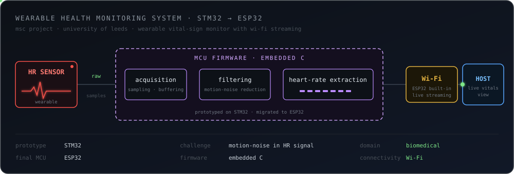

<div align="center">


<br/>

<a href="mailto:vishnu.devag@outlook.com"></a>
<a href="https://github.com/vishnudevav"></a>


</div>

---

## `$ dmesg | grep flagship`

<a href="https://github.com/vishnudevav/wearable-health-monitor"></a>

---

## `$ cat about_me.h`

```c
typedef struct {
    const char *name;
    const char *role;
    const char *education[2];
    const char *experience[2];
    const char *focus[5];
    const char *status;
} Engineer;

const Engineer vishnu = {
    .name       = "Vishnudeva Govindarajan",
    .role       = "Embedded Systems Engineer",
    .education  = { "MSc Embedded Systems Engineering - University of Leeds (2026)",
                    "BEng Electronics & Communication Engineering - Anna University" },
    .experience = { "Embedded Systems Engineer Trainee - Emertxe Information Technologies",
                    "Digital Hardware & Embedded Systems Intern - Tessolve Semiconductor" },
    .focus      = { "Bare-metal firmware on STM32 / ARM Cortex-M",
                    "FPGA design in Verilog / VHDL (Quartus + ModelSim)",
                    "Wearable & biomedical sensing systems",
                    "IoT devices with ESP32 and Wi-Fi connectivity",
                    "Hardware-software co-design" },
    .status     = "Open to full-time embedded / IoT roles"
};
```

---

## `$ ls ./skills`

**Languages**


**HDL & Digital Design**


**FPGA Tools**


**Microcontrollers & Interfaces**


**Tools**


---

## `$ ls ./projects`

### 01 · Wearable Health Monitoring System
> **MSc Project, University of Leeds**

A multi-sensor wearable that monitors heart rate, SpO2, ECG, body temperature, skin conductance (GSR) and motion (IMU). I prototyped it on STM32, then moved it to ESP32 to get built-in Wi-Fi for live data streaming. The hardest part was the signal: heart-rate readings were noisy and jumped, especially when the wearer moved. I worked on filtering and processing to make them stable.

    

[](https://github.com/vishnudevav/wearable-health-monitor)

### 02 · FPGA Human Reaction Timer
> **MSc Coursework · DE1-SoC**

A reaction-time tester written in Verilog on the DE1-SoC board. It uses a finite state machine to control the test, with timing, debouncing, and seven-segment display output, all verified in ModelSim before running on hardware.

   

[](https://github.com/vishnudevav/fpga-reaction-timer)

### 03 · Maze Escape Game
> **MSc Coursework · DE1-SoC (ARM Cortex-A9)**

A maze game running on the ARM Cortex-A9 hard processor of the DE1-SoC, rendered on an LT24 LCD. Includes the display driver, input handling, and the game logic loop.

  

[](https://github.com/vishnudevav/maze-escape-de1soc)

### 04 · Car Black Box
> **Emertxe Information Technologies**

An automotive event-logging system modelled on a vehicle black box. It monitors vehicle events, timestamps them, and stores the log, using SPI and UART to communicate with peripherals.

    

[](https://github.com/vishnudevav/car-black-box)

### 05 · LSB Image Steganography
> **Emertxe Information Technologies**

A C++ tool that hides a secret message inside a BMP image by changing the least significant bit of each pixel, and recovers it again, using bit-level file handling.

 

[](https://github.com/vishnudevav/lsb-steganography)

---

## `$ git log --stat`

<div align="center">


</div>

---

## `$ cat education.txt`

| | |
|---|---|
| 🎓 **MSc Embedded Systems Engineering** | University of Leeds, UK · 2026 |
| 🎓 **BEng Electronics & Communication Engineering** | Sri Ramakrishna Engineering College, Anna University |
| 📚 **Currently studying** | Electrical Engineering with Robotics · PSB Academy, Singapore |
| 📄 **Publication** | Co-author, *Annals of the Romanian Society for Cell Biology* |

---

<div align="center">


</div>
